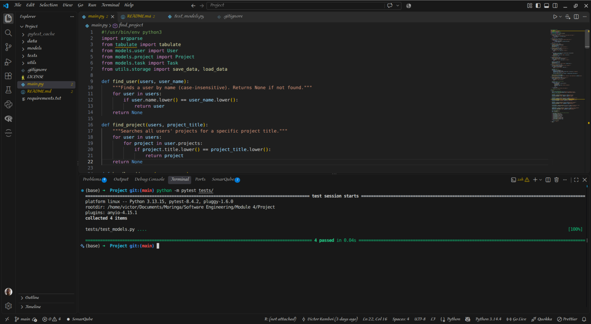

# Python Project Management CLI Tool

## Table of Contents

- [Overview](#overview)
- [Features](#features)
- [Architecture & OOP design](#architecture--oop-design)
- [Setup Instructions](#setup-instructions)
- [Command Line Commands](#cli-commands)
- [Testing](#testing)
- [Screenshot](#screenshot)
- [Contact](#contact)
- [License](#license)

## Overview

A command-line interface (CLI) tool built with Python to manage users, projects, and tasks. It features object-oriented design, JSON persistence, and a modular file structure.

## Features

- **User Management:** Create users with names and emails.
- **Project Tracking:** Assign projects to users with optional due dates and descriptions.
- **Task Management:** Add tasks to projects and mark them as complete.
- **Persistence:** All data is saved to and loaded from `data/data.json`.
- **Pretty Output:** Utilizes the `tabulate` package for clean, formatted CLI tables.

## Architecture & OOP Design

- **Inheritance:** `User` inherits from the base `Person` class.
- **Encapsulation:** `Project.due_date` uses `@property` and setters to validate the `YYYY-MM-DD` format.
- **Relationships:**
  - One-to-many: `User` → `Project` → `Task`.
- **Modularity:** Code is split into `models/` (classes), `utils/` (file I/O), and `main.py` (CLI logic).

## Setup Instructions

1. Clone the repository:

```bash
   git clone git@github.com:Victor-Mufasa/Python-Project-Management-CLI-Tool.git
   cd Python-Project-Management-CLI-Tool
```

2. Install Dependencies

```bash
pip install -r requirements.txt
```

## CLI Commands

Run

```bash
python main.py --help
```

to see all commands.

```text
usage: main.py [-h] {add-user,add-project,add-task,list-projects,complete-task} ...

Project Management CLI Tool

positional arguments:
  {add-user,add-project,add-task,list-projects,complete-task}
                        Available commands
    add-user            Add a new user
    add-project         Add a project to a user
    add-task            Add a task to a project
    list-projects       List projects for a user
    complete-task       Mark a task as complete

options:
  -h, --help            show this help message and exit
```

## Run the CLI (Example):

```bash
python main.py add-user --name "Victor" --email "victor@email.com"
python main.py add-project --user "Victor" --title "CLI Tool" --due-date "2026-12-31"
python main.py add-task --project "CLI Tool" --title "Implement add-task"
python main.py list-projects --user "Victor"
python main.py complete-task --project "CLI Tool" --task "Implement add-task"
```

## Testing

Testing
Unit tests are written using pytest:

```bash
python -m pytest tests/
```

## Screenshot



## Contact

For any feedback questions or improvements ideas feel free to reach out at:
<victorkipkemboi241@gmail.com> or <rickvick142@gmail.com>

## License

MIT License

Copyright © 2026 Victor Kipkemboi

Permission is hereby granted, free of charge, to any person obtaining a copy of this software and associated documentation files (the "Software"), to deal in the Software without restriction, including without limitation the rights to use, copy, modify, merge, publish, distribute, sublicense, and/or sell copies of the Software, and to permit persons to whom the Software is furnished to do so, subject to the following conditions:

The above copyright notice and this permission notice shall be included in all copies or substantial portions of the Software.

THE SOFTWARE IS PROVIDED "AS IS", WITHOUT WARRANTY OF ANY KIND, EXPRESS OR IMPLIED, INCLUDING BUT NOT LIMITED TO THE WARRANTIES OF MERCHANTABILITY, FITNESS FOR A PARTICULAR PURPOSE AND NONINFRINGEMENT. IN NO EVENT SHALL THE AUTHORS OR COPYRIGHT HOLDERS BE LIABLE FOR ANY CLAIM, DAMAGES OR OTHER LIABILITY, WHETHER IN AN ACTION OF CONTRACT, TORT OR OTHERWISE, ARISING FROM, OUT OF OR IN CONNECTION WITH THE SOFTWARE OR THE USE OR OTHER DEALINGS IN THE SOFTWARE.
